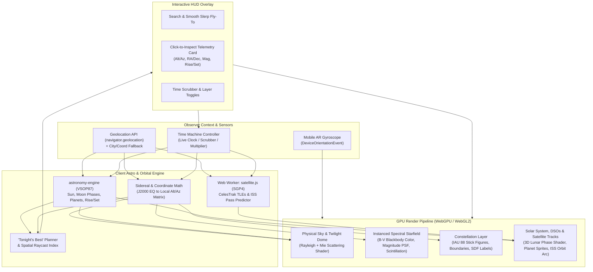

# Stargazer — System & Shader Architecture

Browser-based, GPU-accelerated celestial observation platform anchored to the user's live geographic location and time.

---

## 1. Hosting & Cloud Infrastructure (Azure)

Stargazer runs entirely client-side and requires a **Secure Context (`HTTPS`)** for both the browser Geolocation API (`navigator.geolocation`) and WebGPU (`navigator.gpu`), as well as edge caching for binary star catalogs.

### Selected Azure Architecture
- **Hosting Service**: **Azure Static Web Apps (`Free` SKU)**
- **Configuration & Secrets**: Subscription IDs, resource group names, and deployment tokens are kept out of version control and injected via local environment variables (`.env.local`) or GitHub Actions Secrets (`AZURE_STATIC_WEB_APPS_API_TOKEN`).

| Capability | Azure Static Web Apps (Free Tier) | Azure Blob Storage (`$web`) |
| :--- | :--- | :--- |
| **Monthly Cost** | **\$0.00 / month** (100 GB bandwidth, 250 MB storage) | ~\$0.05/mo raw storage, plus CDN/Front Door egress & profile fees for custom SSL/CDN |
| **HTTPS / TLS** | **Built-in & automated** for `.azurestaticapps.net` and custom domains | Default endpoint only; custom domain HTTPS requires Azure Front Door / CDN |
| **Global CDN & Compression** | **Built-in global edge network** with automatic Brotli/Gzip compression | Single-region bucket unless paired with Azure Front Door |
| **GitHub CI/CD & Previews** | **Native integration** with GitHub Actions + PR staging URLs | Requires manual GitHub Actions + SAS/OIDC upload script |

---

## 2. Technology Stack

### GPU Rendering: Three.js (`WebGPURenderer` + `WebGL2` Fallback)
- Uses Three.js `WebGPURenderer` with Three.js Shading Language (TSL) node materials and instanced/attribute buffers.
- Compiles to **WGSL** on WebGPU-capable browsers (Chrome, Edge, Safari) and automatically falls back to **GLSL / WebGL2** where WebGPU is unavailable.
- **Zero-CPU-Overhead Diurnal Rotation**:
  - Star Right Ascension ($\alpha$) and Declination ($\delta$) are converted into J2000 unit 3D vectors once at startup and uploaded to a static GPU buffer.
  - Per frame, the CPU computes the observer's **Local Apparent Sidereal Time ($\text{LAST}$)** from their longitude ($\lambda$) and timestamp, passing a single $4\times 4$ Equatorial-to-Horizontal ($\text{Alt/Az}$) rotation matrix uniform to the GPU.
  - Renders 100,000+ stars in **1 draw call** at 60–120 FPS.

### Astronomical Ephemeris & Orbital Propagation
- **Solar System (`astronomy-engine`)**: Lightweight, zero-dependency VSOP87 / NOVAS calculations in TypeScript/JavaScript. Computes sub-arcminute topocentric positions (observer latitude, longitude, elevation, atmospheric refraction), rise/transit/set times, and lunar illumination phase angles for the Sun, Moon, and Mercury–Neptune.
- **Satellites & ISS (`satellite.js` + CelesTrak GP API)**: Fetches current Two-Line Element (TLE / OMM) sets from CelesTrak for the ISS and bright visual satellites, running SGP4 orbital propagation in a Web Worker to convert Earth-Centered Inertial (TEME) coordinates into local Alt/Az coordinates.

### Curated Celestial Datasets
- **Star Catalog (`HYG v4.1` / `Yale Bright Star` Binary Pack)**:
  - Compact binary file (`stars.bin`) storing `Float32` tuples `[RA_rad, Dec_rad, Vmag, BV_color, HIP_id]`.
  - Covers ~30,000 to ~100,000 stars down to visual magnitude $7.5$ in `< 600 KB` compressed.
  - Paired with a JSON index of IAU proper star names and the 88 IAU constellation stick-figure polylines and boundary polygons.
- **Deep Sky Objects (Messier + Caldwell)**:
  - JSON catalog of 219 galaxies, nebulae, and star clusters with J2000 coordinates, visual magnitude, angular dimensions, morphological class, and common names (e.g., `M31 Andromeda Galaxy`, `M42 Orion Nebula`).

---

## 3. System Data Flow

---

## 4. Custom GPU Shader Specifications

### Spectral Starfield Shader
- **Color Temperature**: Maps each star's $B-V$ color index to Planckian blackbody RGB via Ballesteros' formula:
  $$T_{\text{eff}} = 4600 \left(\frac{1}{0.92(B-V) + 1.7} + \frac{1}{0.92(B-V) + 0.62}\right)$$
- **Magnitude PSF Scaling**: Computes relative flux $F = 10^{-0.4(m - m_0)}$ to render a bright core with a soft Gaussian/Airy halo for bright stars ($m < 2$) and crisp sub-pixel pinpoints for faint stars ($m > 5$).
- **Atmospheric Scintillation & Extinction**: Applies airmass-dependent dimming ($X \approx 1 / \sin(\text{Alt})$) and high-frequency simplex noise twinkling that intensifies near the horizon ($\text{Alt} < 20^\circ$).

### Physical Sky & Twilight Scattering Shader
- Evaluates Rayleigh (molecular) and Mie (aerosol) atmospheric scattering in the fragment shader driven by the Sun's live altitude vector from `astronomy-engine`.
- Smoothly transitions between daytime sky, golden sunset/sunrise horizon glow, civil/nautical/astronomical twilight, and deep night sky.
- Anchored by a 360° cardinal compass horizon ring (`N`, `NE`, `E`, `SE`, `S`, `SW`, `W`, `NW`).
